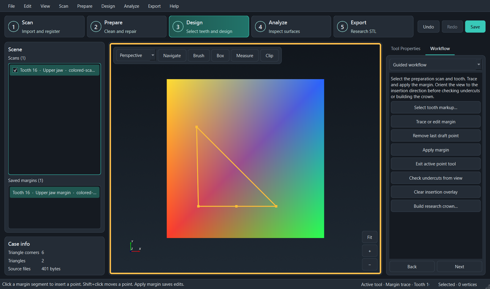

# ZahnCAD

Free, local-first dental CAD research project for Windows and Linux.
ZahnCAD lets you inspect and prepare scans, trace tooth margins, and prototype
single crowns. Licensed under GPL-3.0-or-later.



*Margin editing in the guided Design workspace, using a synthetic scan.*

## Features

- **Guided workflow and Expert tools.** Move through Scan, Prepare, Design,
  Analyze, and Export. A teal viewport border marks vertex brushing and an
  amber border marks margin tracing.
- **Scan import and viewing.** Open STL, PLY, and OBJ scans, including vertex
  colors where supported. Assign roles and scales, adjust visibility and opacity,
  and use standard views, clipping, and PNG screenshots. Large meshes use
  simplified display geometry during navigation and return to full detail afterward.
- **Reversible scan preparation.** Select vertices with a brush or box, crop,
  isolate components, clean faces, fill small holes, smooth, or simplify.
  Review the edit preview and sampled deviation before applying it.
- **Registration and tooth margins.** Align scans using three landmark pairs.
  Save separate margins for multiple FDI teeth on one scan. Insert, move, and
  remove draft points with Undo and Redo.
- **Insertion, blockout, and research crowns.** Save an insertion direction per
  tooth for undercut analysis and crown generation. Generate a blockout from
  the current view or build a hollow research crown. For a prepared tooth,
  sample the scanned surface inside its convex margin to shape the cavity.
- **Freeform smoothing.** Brush a visible area of a restoration candidate and
  release to smooth it. Undo or redo individual strokes and reopen the edited case.
- **Measurement and export.** Measure point-to-point distances and sampled
  surface separation, record repeat readings in a CSV, and export research STL.
  The headless `zahncad-cli` also inspects and converts STL files.
- **Local cases and recovery.** Save source and edited meshes in a `.zahncad`
  project, reopen recent cases, and recover from either of two autosave snapshots.

[Controls (F12)](docs/CONTROLS.md) · [Scan preparation guide](docs/SCAN_PREPARATION.md)
· [Capability status](docs/FEATURES.md) · [Roadmap](docs/ROADMAP.md)
· [Verification record](docs/VERIFICATION.md)

The [M0 research evaluation](docs/EVALUATION.md), [M1 acceptance checklist](docs/M1_ACCEPTANCE.md),
and [viewer reliability notes](docs/RELIABILITY.md) describe the remaining evaluation work.

## Build the core

Requires CMake >=3.24 and a C++20 compiler.

```sh
cmake -S . -B build -DBUILD_TESTING=ON
cmake --build build --config Release
ctest --test-dir build -C Release --output-on-failure
```

## Build the desktop

On Windows, the workspace-local MSYS2 UCRT64 toolchain can be used with:

```powershell
.\scripts\build-windows.ps1
python scripts/package_windows.py --prefix build/toolchain/msys64/ucrt64
.\out\ZahnCAD\zahncad.exe
```

The packaging script copies the executable, Qt platform/SQLite plugins and the
recursive MinGW DLL dependencies into `out/ZahnCAD`. Keep the entire folder
together when moving or distributing it.

On Ubuntu 26.04, install `g++ cmake ninja-build qt6-base-dev libqt6sql6-sqlite
libvtk9-qt-dev libarchive-dev`, then use the desktop CMake commands below.
Ubuntu 24.04's packaged VTK uses Qt5 and does not match this application's Qt6
interface. Linux binary archives target Ubuntu 26.04 and list their runtime
dependencies in the included README.

Install Qt6 Widgets/Sql with the SQLite driver, libarchive, and VTK built with
`VTK_QT_VERSION=6` and `VTK_MODULE_ENABLE_VTK_GUISupportQt=YES`.
Set `CMAKE_PREFIX_PATH` to these installations, then:

```sh
cmake -S . -B build-desktop -DZAHNCAD_DESKTOP=ON
cmake --build build-desktop --config Release
cmake --install build-desktop --config Release --prefix out
```

Alternatively use the supplied vcpkg manifest and its CMake toolchain. It is a
dependency inventory, not yet a reproducibly pinned toolchain. Desktop builds
must use matching Qt major versions throughout. Deploy Qt's platform and SQL
plugins and VTK/libarchive runtime libraries when distributing a build.

## Current limits

The [M1 packaging instructions](docs/M1_ACCEPTANCE.md) cover the unsigned
Windows x64 installer and Ubuntu 26.04 x86-64 AppImage. The separate Linux
binary archive requires matching system runtime packages.

The importer caps input at 10 million triangles; inspection uses exact shared
coordinates and is memory-intensive. Research STL export does not imply
manufacturability. Self-intersections, thickness, fit and clinical suitability
are not checked. Anatomical crown generation and the tooth library remain open.
General self-intersection/non-manifold repair and professional
release gates remain planned. OBJ/PLY image textures and point clouds are not supported.
Manual save remains synchronous; undo history is session-local and is not stored
in project files. Patient data stays local; the program has no network services.

## Reliability and performance checks

The desktop build includes `project_tests` and `viewer_tests`. For a reproducible
synthetic throughput test:

```sh
python scripts/generate_stress_stl.py build-desktop/curved-stress.stl
build-desktop/viewer_benchmark build-desktop/curved-stress.stl
```

`zahncad --smoke-test input.stl screenshot.png` exercises cancellation, async
import, undo/redo, scan removal/restore, navigation LOD and clean shutdown.
With `examples/triangle.stl` it also checks surface measurement and clipping,
then uses Recent Cases to reopen a saved two-scan project. It writes
`screenshot.png.ruler.png` and `screenshot.png.zahncad` for that fixture.
On Linux run it with `xvfb-run -a` if no display is available. The synthetic
fixture is a curved plate, not dental anatomy; real scan performance still
requires representative cases and workstation-specific evaluation.

`zahncad --stage2-smoke-test examples/colored-scan.ply screenshot.png` exercises
actual face picking, crop-box bounds, async cropping, undo/redo, color rendering
and edited-project persistence. It writes `screenshot.png.zahncad` as a synthetic
interoperability fixture. Automated preparation is enabled only by this explicit
test argument; interactive operations always offer Apply/Cancel.

`zahncad --m3-smoke-test examples/colored-scan.ply screenshot.png` exercises the
FDI chart, margin editing, registration, blockout undo, crown generation,
project reopening and sampled separation on the synthetic case.

See [development roadmap](docs/ROADMAP.md) and [project format](docs/FORMAT.md).
